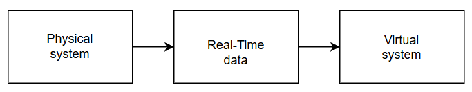
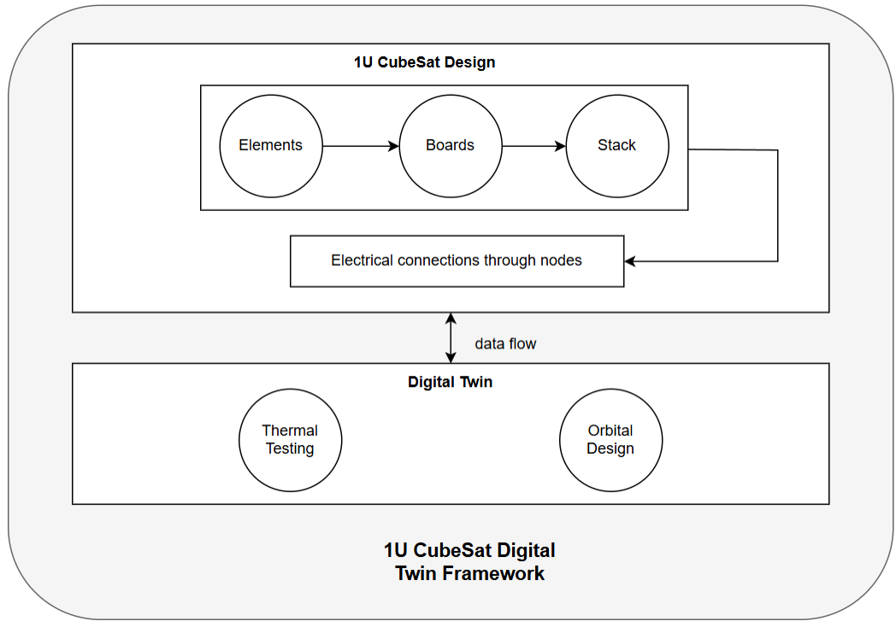
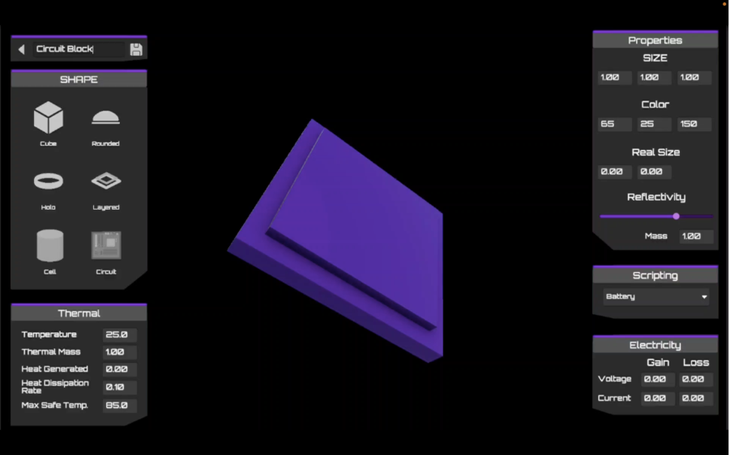
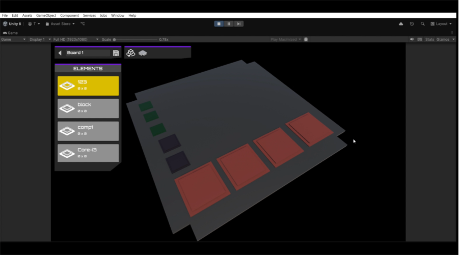
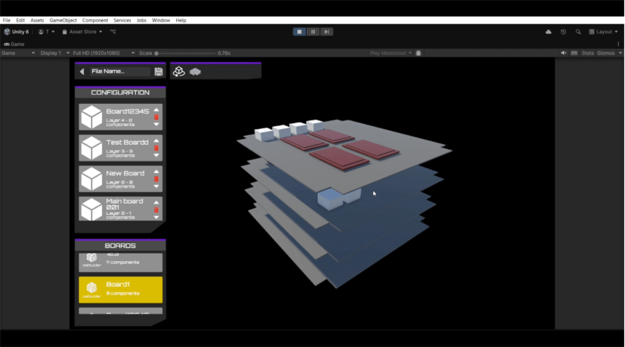
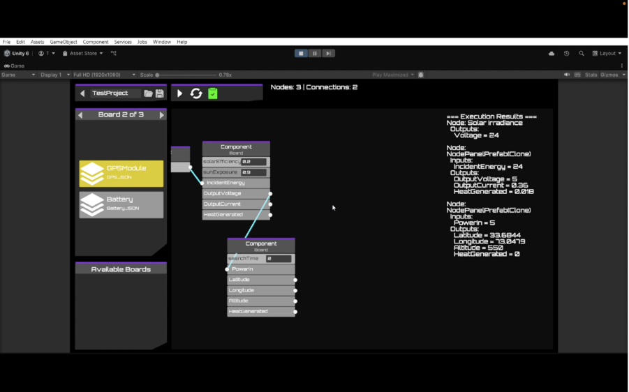
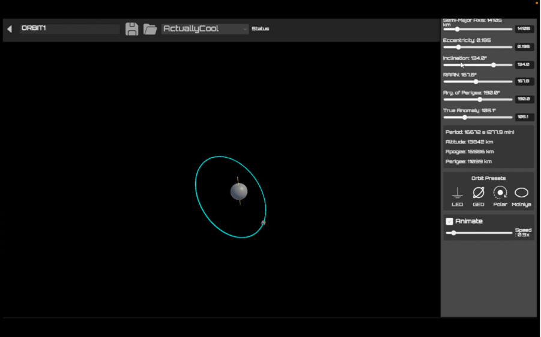
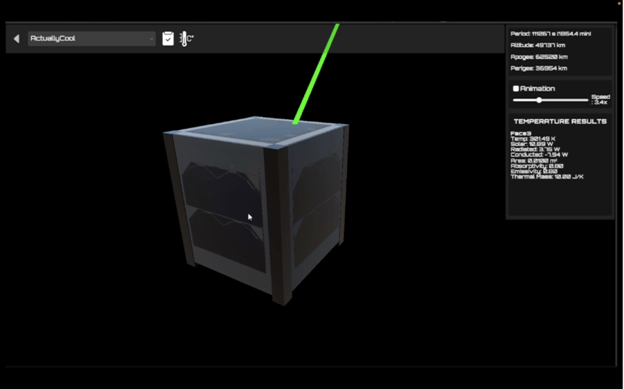

# Design and Development of a Digital Twin for a 1U CubeSat

_Note on source code: The source code for this project is kept private. This repository instead documents the project's methodology, architecture, and features, and includes screenshots of the software along with a preview video demonstrating each feature (see **[Software Preview](https://drive.google.com/drive/folders/1E7x9T0EJkNkIT8lyUcInd9Uu3X_MBSAc?usp=sharing))**._ 

## Overview

This final year project, developed by a group of three, is a software platform that lets users design a 1U CubeSat and simulate its digital twin in terms of thermal and orbital behaviour. The framework brings together structural design, thermal analysis, and orbital modelling in a single three-dimensional environment, so that subsystems can be visualised and evaluated effectively.

A CubeSat is designed hierarchically from **elements**, which are placed on **boards**, which are assembled into **stacks**, and which are then linked through **nodal connections**. The resulting design is used to evaluate the satellite's thermal performance and orbital behaviour using real orbital data. Together, this simulated environment forms the digital twin of the 1U CubeSat.

**Scope:** The simulations run under idealised space-environment conditions created virtually, and the platform is limited to 1U CubeSats.

## Software Preview

A screen-recorded preview video walks through each feature of the software, from CubeSat design to orbit simulation and thermal analysis.

- Preview video: **[Watch on Google Drive](https://drive.google.com/drive/folders/1E7x9T0EJkNkIT8lyUcInd9Uu3X_MBSAc?usp=sharing)**

Screenshots of each module are included in the sections below.

## **Background**

Two concepts underpin the software:

- **1U CubeSat:** A standardised nanosatellite measuring 10 cm × 10 cm × 10 cm with a mass of 1.33 kg or less.

- **Digital Twin:** A virtual representation of a physical system that allows engineers to simulate scenarios in real time, monitor performance, and optimise operation throughout the system's lifecycle.

The digital twin architecture was first proposed by Michael Grieves, who defined three main parts: the **physical space** (the real-world product), the **virtual space** (a detailed replicated simulation of the physical system), and a **bidirectional flow of data and information** linking the two. The architecture is shown below.

## Software Framework

Our framework is divided into two main parts: **CubeSat Design** and **Digital Twin.**

## CubeSat Design

The interface is deliberately organised into clear stages to balance technical accuracy with usability. A CubeSat involves many interconnected subsystems, and traditional tools often overwhelm users by exposing too much detail at once. Separating the process into stages lets users focus on one aspect at a time while keeping a consistent overall framework, which reduces cognitive load.

**1. Elements**

The primary interface for defining and configuring individual CubeSat components.

- **Designation panel:** manages a component's identity, including renaming, saving, and reverting to earlier versions.
- **Shape panel:** offers six base geometric templates (cube, rounded, halo, layered, cell, and circuit), each resizable to match the physical characteristics of the component it represents.
- **Scripting panel:** assigns logic or behavioural scripts that simulate processes such as heat transfer, electrical interactions, or communication.

**2. Boards**

The environment for arranging components onto functional boards.

- **Elements panel:** a catalogue of available components, allowing multiple elements to be placed on a single board to reflect realistic subsystem groupings.
- **Controller panel:** manages placement and interaction. In placement mode, users position ghost elements on the board, with collision and boundary checks preventing invalid configurations.
- **Overlays:** thermal and power distribution overlays give immediate feedback on heat concentration and energy usage across the board.

**3. Stacks**

The environment where individual boards are assembled into a complete CubeSat stack.

- **Boards panel:** lists all previously designed boards so they can be easily selected for inclusion.
- **Configuration panel:** defines and adjusts the stacking sequence, forming the physical and functional structure of the satellite.

**4. Connections**

Logical relationships between components are defined in a visual node editor. Each node represents a component and exposes the inputs and outputs declared in its assigned script. Users create links by dragging from an output on one node to a compatible input on another, which makes data and power paths explicit and easy to audit. This gives a clear and reliable environment for building and validating the internal logic of the CubeSat.

## Digital Twin

**1. Orbit Simulation**

The orbital model follows the laws of Keplerian motion. The satellite's position and trajectory are determined by the six classical orbital elements: semi-major axis (a), eccentricity (e), inclination (i), right ascension of the ascending node (Ω), argument of perigee (ω), and true anomaly (ν).

- **Orbit designer panel:** accepts the six Keplerian elements so that orbits follow standard orbital mechanics conventions. Derived values such as altitude, apogee, and perigee are calculated and displayed automatically, helping users check the practicality of their design.
- **Presets:** common orbit types, including low Earth orbit, geostationary orbit, polar orbit, and Molniya orbit.
- **TLE import:** loads real orbit data directly for accurate mission planning.
- **Coverage visualisation:** displays ground station visibility regions as circles projected onto the Earth, showing when and where communication links are possible.

Together, these features make the Orbit Designer a precise and intuitive space for planning and testing orbital trajectories.

**2. Thermal Analysis**

The thermal module is based on the Stefan–Boltzmann law, which relates the radiation emitted by a body to its temperature. The simulation accounts for solar radiation, internal conduction between components, and external environmental factors such as eclipse periods.

- **Thermal toggle:** visualises heat distribution across the CubeSat, giving immediate insight into thermal behaviour under different orbital conditions.
- **Data export:** results can be exported as CSV files for deeper offline analysis.
- **Ground station link visualisation:** projects uplink and downlink beams during visible passes to test communication feasibility.

## Related Project

To complement this digital twin, we also created detailed 3D models of the 1U CubeSat subsystems in Blender (structure, EPS, OBC, communication system, ADCS and camera payload), including editable source files and rotating preview clips.

- **Digital twin project:** [Designed 1U CubeSat Subsystems using Blender](https://github.com/neptune-original/Digital-Twin-of-1U-CubeSat)

## Notes

All software, models, images and videos in this project are the work of our project group. Please contact me before reusing or redistributing them.
